<div align="center">



# BTC Rule-Based Spot Paper Trader

**Deterministic BTC-USD research. No model training, AI inference or exchange orders.**

[Live paper dashboard](https://thelouismahdi.github.io/btc-hourly-forecast/) | [Methodology](docs/RULE_BASED_STRATEGY.md) | [Legacy AI documentation](docs/LEGACY_AI_README.md)

 

</div>

## Active architecture

The **hourly GitHub workflow** runs only scripts/rule_based.py, and its **dashboard workflow** runs only scripts/render_rules_dashboard.py. Both use the separate rule-state branch. Old AI training modules, historical model-state and forecast-state records remain archived for comparison, **not imported by the new runtime**. The retrain workflow is legacy manual tooling only.

This is a fixed-hypothesis system, **not an experimentally proven best Bitcoin strategy**. No live or out-of-sample profitable performance is claimed. No trading API credentials are required.

## Strategy

* Product: Coinbase BTC-USD spot, long or cash, **never short or leverage**.
* Only finalized **hourly candles** are accepted.
* **Buy** if the closed price breaks the prior 55-candle high and exceeds EMA(200), with ATR(14)/price between 0.2% and 6%.
* **Exit** for an ATR-based simulated stop, a close below the prior 20-candle low or a close below EMA(200).
* **Position sizing**: at most 0.5% of paper equity exposed to initial stop risk and at most 50% of paper cash allocated. Stop distance is 3 × ATR(14).
* Default paper assumptions: 15 bps trading fee and 3 bps slippage **per side**, not a claim about Coinbase's actual fee tier.
* Any data gap, stale quote or missed processing hour causes **FAIL_SAFE** and requires manual reconciliation before resuming.
* These stops exist **only in the simulation** and are evaluated using completed candles. They are **not broker stop orders**.

## Run locally

Python 3.11 or newer; standard library only for the new runtime.

```bash
python -m unittest discover -s tests -p 'test_rule_based.py' -v
python scripts/rule_based.py --state-dir .rule_state
python scripts/render_rules_dashboard.py
```

The first command performs offline tests. The second requests public Coinbase market data and writes isolated paper-state JSON. The third builds site/index.html.

The scheduled workflow is .github/workflows/forecast.yml; deployment uses .github/workflows/dashboard.yml. To reset a stuck FAIL_SAFE after a missed candle, inspect and explicitly reconcile the active paper position and last processed timestamp in rule-state. **Never silently skip unknown price history.**

## Backtest

```bash
python scripts/backtest_rules.py hourly_ohlcv.csv --out-of-sample-fraction 0.30
```


Required CSV columns: time (UTC epoch seconds), open, high, low, close, volume. Candles must be hourly, sorted, complete and gap-free. Signals use closed bars and **next bar's opening price**, with assumed transaction costs. The out-of-sample segment uses the most recent 30% of candles. Avoid searching dozens of parameters and then reporting the best historical result.

**Decision to deploy with real capital must be separate from this PR.** Live fills, actual fees, data resiliency, market regimes and long out-of-sample outcomes require independent validation.
